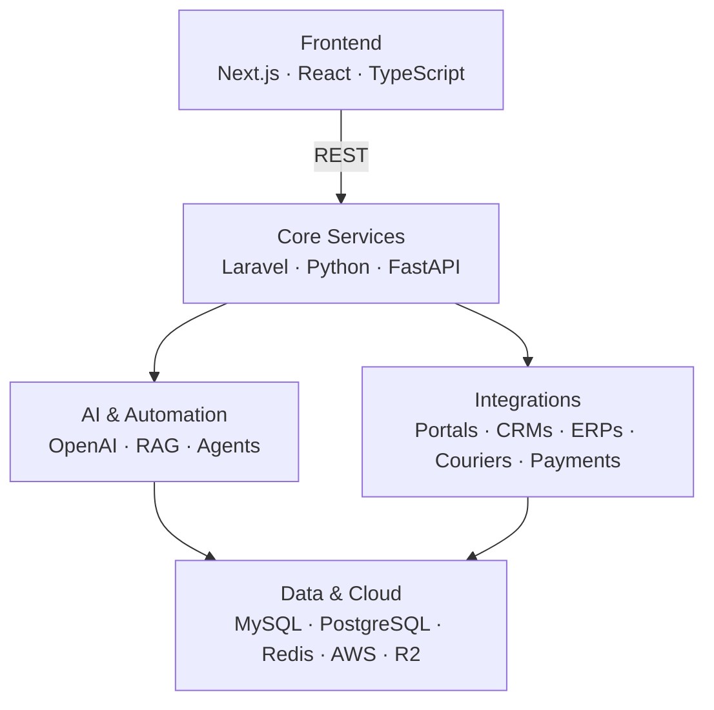

# Khuzemah Saeed

**Senior Full Stack Developer / Backend & AI Engineer.** I build and integrate the platforms businesses run on: property portals, CRMs, payroll, logistics and AI lead automation, using Python, Laravel and Next.js.

📍 Lahore, Pakistan · GMT+5 · Remote, with 4+ hours of overlap with US, EU & Gulf teams

---

## At a Glance

| 6+ years | 15,000+ | 80% | 58% |
|:---:|:---:|:---:|:---:|
| shipping production systems since 2020 | property units synced across Property Finder, Bayut & Dubizzle | less manual fulfilment via automated courier dispatch | faster page loads (LCP) across 15+ e-commerce sites |

**Integrated in production:** Property Finder · Bayut · Dubizzle · Rightmove · Bitrix24 · HubSpot · Cin7 · ChannelAdvisor · TCS · Leopards · M&P · Stripe · PayPal · Afterpay · Sudonum · Cloudflare R2 · OpenAI · Reelly API

---

## Tech Stack

**Backend** 

**Frontend** 

**AI & Automation** 

**Data & Infrastructure** 

**Platforms** 

---

## Featured Work

> Production systems, not side projects. Full write-ups with screenshots are in my **[case studies](https://portfolio-khuzemah-saeed.vercel.app/projects)**.

### UAE Property Portal Sync & AI Lead Hub
[Case study](https://portfolio-khuzemah-saeed.vercel.app/projects#case-uae-proptech) · *Lead Systems Architect*

- Two-way listing sync with **Property Finder, Bayut and Dubizzle**, covering **15,000+ units**
- Call tracking via Sudonum and an AI bot that qualifies buyers and routes clean leads to brokers in **under 3 seconds**
- Bitrix24 CRM automation for lead assignment and follow-up

`Laravel` `Next.js` `Python` `Bitrix24` `Sudonum`

### TalentFilter AI — Explainable Resume Screening
[Case study](https://portfolio-khuzemah-saeed.vercel.app/projects#case-talentfilter-ai) · [Code](https://github.com/KHUZEMAHSAEED/ats-screening-platform) · *Lead AI Systems & Backend Architect*

- ATS that parses PDF/DOCX resumes in **under 2 seconds** and scores candidates with visible evidence from the resume text
- Never auto-rejects: every hiring decision stays with a human, shaped by EU AI Act guidance
- Audit view tracking EEOC four-fifths adverse-impact ratios

`Python` `FastAPI` `Next.js 14` `TypeScript` `PostgreSQL`

### Reelly Luxe — Off-Plan Portal & Bitrix24 Deal Matching
[Case study](https://portfolio-khuzemah-saeed.vercel.app/projects#case-reelly-luxe) · [Code](https://github.com/KHUZEMAHSAEED/reelly-realestate-integration-platform) · *Full Stack & PropTech Integration Architect*

- Off-plan property portal on the Reelly API v2.0 behind a secure Node.js BFF
- Matches buyer criteria to inventory in **under 1 second**, with interactive map and live AED/USD/EUR/GBP pricing
- One-click proposals logged directly to Bitrix24 deals

`React 19` `TypeScript` `Node.js` `Express` `Vite` `Leaflet`

### UAE HRM & WPS Payroll Platform
[Case study](https://portfolio-khuzemah-saeed.vercel.app/projects#case-uae-hrm) · *Full Stack Engineer*

- Attendance, leave, loans and end-of-service (gratuity) calculations for **300+ employees**
- One-click, Central Bank-compliant **WPS SIF** payroll file generation
- Role-based access control and audit trails for HR and managers

`Laravel` `Next.js` `MySQL` `AWS S3`

### WiseMarket — 4-Country Marketplace & Logistics
[Case study](https://portfolio-khuzemah-saeed.vercel.app/projects#case-wisemarket) · *Senior Full Stack Developer*

- Marketplace live in **Australia, New Zealand, UAE and Pakistan** with **50,000+ SKUs**
- Cin7 / ChannelAdvisor inventory sync to prevent overselling across marketplaces
- Automated courier dispatch (TCS, Leopards, M&P), cutting manual fulfilment by **80%**

`Laravel` `Next.js` `MySQL` `Cin7` `ChannelAdvisor`

### More case studies

| Project | What it is | Stack |
|---|---|---|
| [HashMove](https://portfolio-khuzemah-saeed.vercel.app/projects#case-hash-move) | Peer-to-peer parcel delivery with route matching and ID verification | PHP 8, WordPress, custom OOP plugin |
| [Al Kithab Academy](https://portfolio-khuzemah-saeed.vercel.app/projects#case-alkithab-academy) | Headless Moodle 4.5 student portal | Moodle, PHP |
| [Slow Rise Pizza](https://portfolio-khuzemah-saeed.vercel.app/projects#case-slowrise-pizza) | D2C video course subscriptions and gifting engine | WooCommerce Subscriptions, PHP 8 |
| [ZenaWalk](https://portfolio-khuzemah-saeed.vercel.app/projects#case-zenawalk) | Multilingual (5-language) audio walking tours for Genoa | Flask, MySQL, Cloudflare R2, Stripe |

---

## Experience

| Period | Role | Highlights |
|---|---|---|
| **Nov 2024 – Present** | Senior Software Developer, **Saabsoft** (Remote) | UAE/MENA real estate platforms, Bitrix24 automation, AI lead qualification, UAE HRM & WPS payroll |
| **Aug 2022 – Oct 2024** | Senior Software Developer, **Oz Techwork / WiseMarket** | 4-country marketplace, courier dispatch automation (−80% manual work), 15+ WordPress sites optimized (up to −58% LCP) |
| **Sep 2020 – Jul 2022** | Software Developer, **Rezaid** *(promoted from Junior)* | Laravel + React film-production platform with HubSpot & Slack automation, role-based employee management system |

**Education:** BSc Computer Science, NUST Islamabad (2016 – 2020)

> *"When Khuzemah leads a piece of work, it moves forward with stability, clarity, and minimal supervision."*
> — Yan Naing Lin · [8 recommendations on LinkedIn](https://www.linkedin.com/in/khuzemah-saeed/details/recommendations/)

---

## How I Build

---

## GitHub Stats

  
  

---

## Get in Touch

Open to **Senior Full Stack, Backend and Lead Engineer** roles, full-time or contract, remote. Reach me at **[khuzemasaeed@gmail.com](mailto:khuzemasaeed@gmail.com)**, on [LinkedIn](https://www.linkedin.com/in/khuzemah-saeed/), or through my [portfolio](https://portfolio-khuzemah-saeed.vercel.app/).
