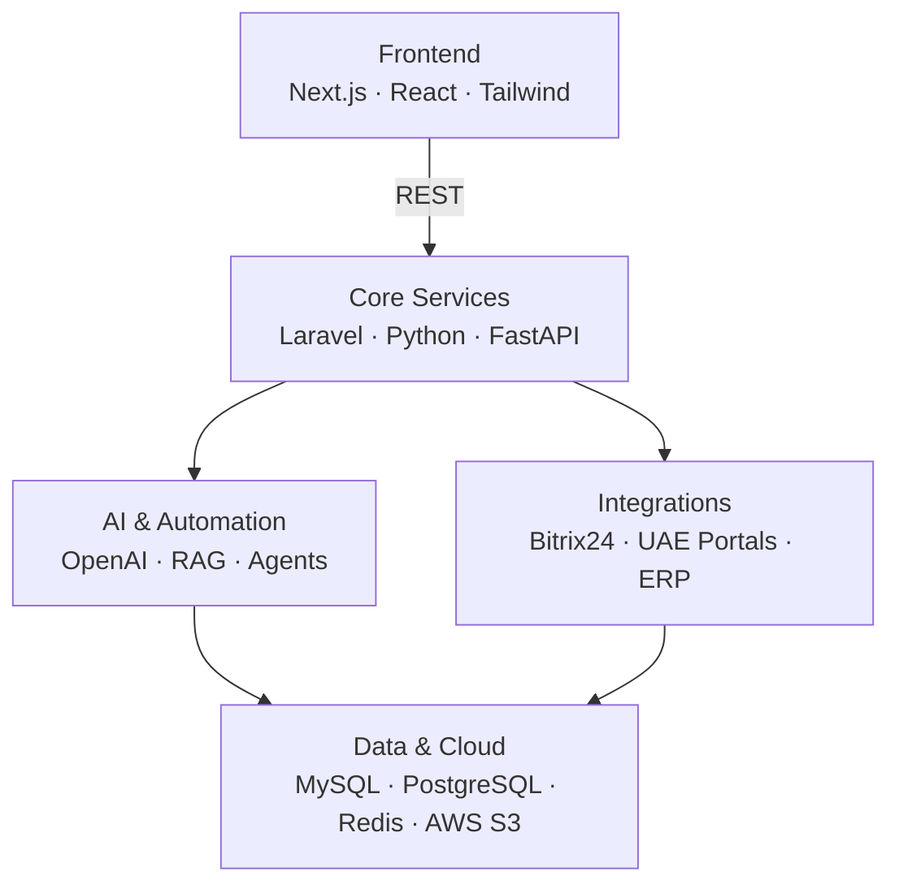

# Khuzemah Saeed

**Senior Full Stack Developer & AI Engineer** — I build AI-powered PropTech, HRM and enterprise integration systems for the UAE market.

---

## About

6+ years building production web platforms, ERP/CRM systems and AI workflow automation.

- **Backend:** Laravel (PHP 8+) and Python/FastAPI, with domain-driven design and well-indexed MySQL/PostgreSQL schemas
- **Frontend:** React.js and Next.js with Tailwind CSS
- **Integrations:** Bitrix24 CRM, UAE property portals (Property Finder, Bayut, Dubizzle), Cin7, ChannelAdvisor
- **AI:** LLM agents, RAG pipelines and automated lead qualification
- **Domains:** PropTech, real estate developer systems, UAE WPS payroll & HRM, e-commerce ERP

---

## Tech Stack

**Backend** 

**Frontend** 

**AI & Automation** 

**Data & Infrastructure** 

**Platforms** 

---

## Featured Work

### PropTech & Real Estate Syndication Platform
Real estate management system for the UAE market.

- Ingestion engine that maps and syncs high-volume XML/CSV listing feeds to **Property Finder, Bayut and Dubizzle**
- LLM chatbot that qualifies inbound buyers 24/7 (budget, criteria, intent score) and pushes qualified leads into **Bitrix24**
- AWS S3 media pipeline with image optimization and CDN caching for property photos and floor plans

`Laravel` `Next.js` `Python` `OpenAI` `MySQL` `AWS S3` `Bitrix24 API`

### Developer Inventory & Booking Platform
Unit inventory, sales approvals and contracts for property developers.

- Building → floor → unit matrix with live status (Available, Reserved, Booked, Sold, Blocked) and database locking to prevent double-booking
- Reservation flow with multi-level approvals, payment milestone schedules and automated PDF contracts
- Indexed schema that filters thousands of units across master communities in **under 100 ms**

`Laravel` `React` `Next.js` `MySQL` `Tailwind CSS`

### UAE HRM & WPS Payroll Engine
HR and payroll system compliant with UAE labour law.

- Payroll engine generating **WPS SIF files** in the Central Bank of UAE format
- Gratuity (EOSB), salary advances, loan deductions and biometric attendance reconciliation
- Role-based access control and audit trails for HR and department managers

`Laravel` `Next.js` `MySQL`

### E-Commerce Performance & Multi-Channel ERP
Optimization and inventory sync across **15+ production stores**.

- Two-way WooCommerce sync with **Cin7 and ChannelAdvisor** to prevent overselling across marketplaces
- Replaced heavy plugins with custom PHP modules, cutting TTFB and page load by up to **45%**
- Conversational assistants for product discovery and order tracking

`WooCommerce` `PHP` `Laravel` `Redis` `Cin7 API` `ChannelAdvisor API`

---

## Experience

| Company | Role | Focus |
|---|---|---|
| **SAABSOFT** | Senior Software Developer | AI real estate platforms, CRM automation, UAE HRM — Laravel, Next.js, Python, OpenAI, Bitrix24 |
| **OZ TECHWORK** | Senior Software Developer | High-scale e-commerce, custom themes/plugins, ERP data migration — WordPress, Laravel, Next.js |
| **REZAID** | Software Developer *(promoted from Junior)* | API-driven business platforms and integrations — Laravel, React, HubSpot, Slack APIs |

<!-- TODO: add years for each role, e.g. 2023 – Present -->

---

## How I Build

---

## GitHub Stats

  
  

---

## Get in Touch

Building a PropTech platform, automating workflows with AI, or scaling a Laravel/Next.js app? Reach me at **[khuzemasaeed@gmail.com](mailto:khuzemasaeed@gmail.com)** or on [LinkedIn](https://www.linkedin.com/in/khuzemah-saeed/).
